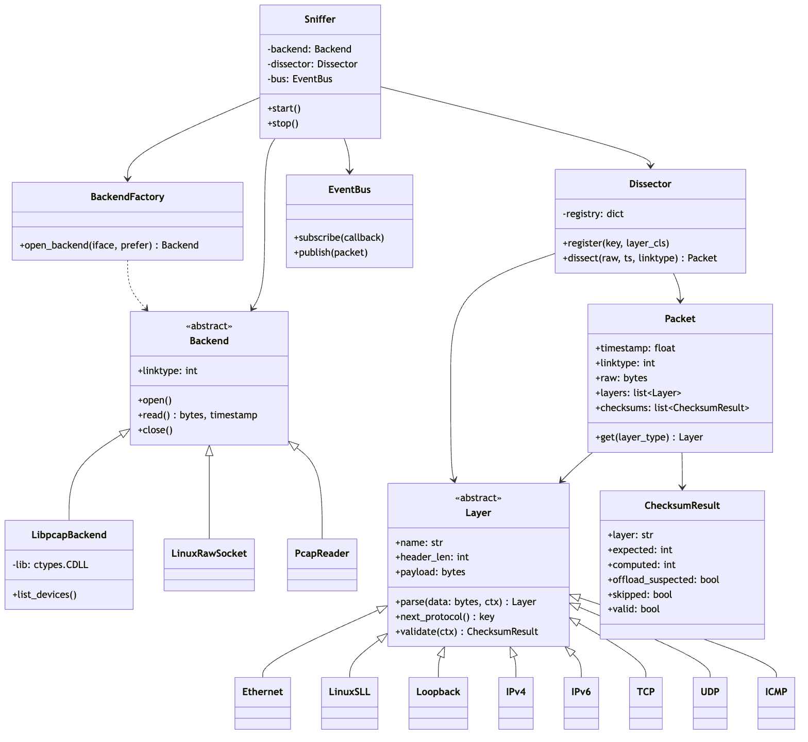

# rawpkt

Sniffer de pacotes de rede escrito em Python, para Windows, macOS e Linux. O rawpkt captura em tempo real os frames que passam pela placa de rede, decodifica cada camada de protocolo (Ethernet, IP, TCP, UDP e ICMP), mostra os campos dos headers e valida os checksums.

A proposta é tornar observável o tráfego de rede, que normalmente é invisível, e servir de ponte entre a teoria de Redes de Computadores e a programação de baixo nível.

> **Estado do projeto:** em desenvolvimento. Hoje só o módulo de checksum está implementado. Veja o [roadmap](#roadmap).

> [!IMPORTANT]
> **Requer Python 3.10 ou mais recente.** Em versões anteriores, o import falha com `TypeError: dataclass() got an unexpected keyword argument 'slots'`. Confira com `python3 --version` antes de rodar. Detalhes em [Requisitos](#requisitos).

## Por que não usar o Wireshark?

Ferramentas prontas mostram o resultado, mas escondem como ele foi obtido. Construir um sniffer do zero obriga a entender na prática:

- como os bytes estão organizados em cada header;
- a ordem de bytes da rede (big-endian);
- o encapsulamento de uma camada dentro da outra;
- como funciona a detecção de erros por checksum.

## Objetivos

- Capturar pacotes em tempo real na interface de rede.
- Decodificar manualmente os headers de cada camada com o módulo `struct`.
- Recalcular e validar os checksums do IPv4, TCP, UDP e ICMP.
- Entregar os pacotes analisados a uma interface de terminal ou desktop.
- Servir de base para estudos e extensões futuras.

## Arquitetura

O projeto tem duas partes:

1. **A biblioteca `rawpkt`**, que cuida de captura, parsing e validação e não depende de nenhuma interface.
2. **As aplicações** que consomem a biblioteca: uma TUI ([Textual](https://textual.textualize.io/)) e/ou uma GUI desktop ([PySide](https://doc.qt.io/qtforpython/)).

### Camadas

| # | Camada | Módulo | Responsabilidade |
|---|--------|--------|------------------|
| 1 | Captura | `capture` | Obtém os bytes crus de cada frame, e o `linktype` da interface, a partir de um backend que pode ser trocado. |
| 2 | Dissecação | `dissector` + `layers` | Transforma os bytes em objetos de camada encadeados. Parte do `linktype` e usa o EtherType e o campo de protocolo do IP para decidir o próximo parser. |
| 3 | Validação | `checksum` | Recalcula os checksums e compara com os valores recebidos. |
| 4 | Distribuição | `events` | Publica cada pacote analisado num barramento de eventos. |
| 5 | Apresentação | `apps` | A TUI ou a GUI se inscrevem nos eventos e exibem os dados. |

### Suporte multiplataforma

O projeto é compartilhado e precisa rodar em Windows, macOS e Linux. Cada sistema expõe a captura de um jeito diferente:

| Sistema | Mecanismo nativo | Backend no rawpkt | Privilégios |
|---------|------------------|-------------------|-------------|
| Linux | `AF_PACKET` ou libpcap | `LibpcapBackend` ou `LinuxRawSocket` | root ou `CAP_NET_RAW` |
| macOS | BPF (`/dev/bpf*`), libpcap já vem no sistema | `LibpcapBackend` | root ou acesso aos `/dev/bpf*` |
| Windows | driver [Npcap](https://npcap.com/) (`wpcap.dll`) | `LibpcapBackend` | administrador, ou Npcap instalado sem restrição |

O backend principal usa a libpcap via `ctypes`, que é a mesma API nos três sistemas (no Windows, fornecida pelo Npcap). Ela só entrega os bytes crus do frame, então todo o parsing e a validação continuam escritos à mão. Os raw sockets nativos do Windows (`SIO_RCVALL`) não servem, porque não entregam a camada Ethernet e capturam mal o tráfego de saída.

O primeiro header nem sempre é Ethernet. No loopback do macOS ele é um header BSD de 4 bytes, e na interface `any` do Linux é o Linux SLL. Por isso o backend informa o `linktype` e o dissector começa a partir dele.

### Estrutura de módulos (planejada)

```
rawpkt/
  capture/
    base.py        # Backend (ABC) + linktype
    factory.py     # open_backend(): escolhe o backend pelo SO
    libpcap.py     # LibpcapBackend (ctypes: libpcap / Npcap)
    linux_raw.py   # LinuxRawSocket (AF_PACKET, alternativa no Linux)
    pcap.py        # PcapReader (arquivos .pcap, puro Python)
    devices.py     # listagem de interfaces
  layers/
    base.py        # Layer (ABC)
    ethernet.py
    linux_sll.py   # interface 'any' do Linux
    loopback.py    # loopback BSD (macOS)
    ipv4.py
    ipv6.py
    tcp.py
    udp.py
    icmp.py
  checksum.py      # internet_checksum, pseudo-headers
  dissector.py     # parte do linktype, nunca assume Ethernet
  packet.py        # Packet (pilha de camadas + metadados)
  events.py        # EventBus / fila
  sniffer.py       # Sniffer (orquestra tudo)
tests/
  fixtures/*.pcap  # rodam nos 3 SOs, sem privilégios
apps/
  tui/
  gui/
```

### Diagrama de classes



Fonte editável: [`docs/diagrams/classes.mmd`](docs/diagrams/classes.mmd)

### Fluxo de captura de um pacote


Fonte editável: [`docs/diagrams/sequencia.mmd`](docs/diagrams/sequencia.mmd)

### Decisões de projeto

- **Biblioteca separada da interface.** As apps só consomem o `EventBus`. Isso facilita os testes e permite trocar a interface sem reescrever o núcleo.
- **Parsing manual, Scapy só nos testes.** Usar o [Scapy](https://scapy.net/) no núcleo esconderia exatamente o que se quer aprender. Por isso o parsing é escrito à mão com `struct`, e o Scapy serve só de referência para conferir os resultados nos testes.
- **Captura atrás de uma abstração.** A ABC `Backend` isola a origem dos frames, e o `open_backend()` escolhe a implementação de acordo com o sistema. O `PcapReader` permite testar com tráfego gravado, sem rede ao vivo.
- **Multiplataforma sem extensões compiladas.** O backend principal é o `LibpcapBackend`, que carrega via `ctypes` a libpcap (Linux e macOS) ou a `wpcap.dll` do Npcap (Windows). O `LinuxRawSocket` (`AF_PACKET`) fica como alternativa sem dependências no Linux.
- **O dissector nunca assume Ethernet.** Ele começa pelo `linktype` informado pelo backend (Ethernet, Linux SLL ou loopback BSD).
- **Checksum offload não é erro.** Pacotes de saída com checksum divergente são marcados como `offload_suspected` em vez de acusados como corrompidos.
- **Testes nos três sistemas.** Os testes usam fixtures pcap e rodam numa matriz de CI com Windows, macOS e Linux.

## O checksum da internet

O checksum usado pelo IPv4, TCP, UDP e ICMP ([RFC 1071](https://www.rfc-editor.org/rfc/rfc1071)) é a soma em complemento de um de todas as palavras de 16 bits, invertida no final. Quem recebe o pacote recalcula essa soma. Se o valor não bater, o pacote foi corrompido no caminho. No TCP e no UDP, o cálculo também inclui um **pseudo-header** com os endereços IP de origem e destino, o protocolo e o tamanho do segmento.

Dois casos especiais que o rawpkt trata:

- **Checksum offload:** placas de rede modernas calculam o checksum no hardware, depois que o pacote já foi capturado. Por isso, pacotes de saída costumam aparecer no sniffer com checksum "errado". O rawpkt identifica esse caso (`offload_suspected=True`) em vez de acusar erro.
- **UDP sobre IPv4:** o checksum é opcional, e o valor zero significa "não calculado". Nesse caso o resultado vem com `skipped=True` e é considerado válido.

### Uso do módulo `checksum`

```python
from checksum import verify, pseudo_header_v4, OFFSET_IPV4, OFFSET_UDP, PROTO_UDP

# Header IPv4
r = verify("ipv4", ipv4_header, OFFSET_IPV4)
print(r.valid, hex(r.expected), hex(r.computed))

# Segmento UDP, com pseudo-header
ph = pseudo_header_v4(src_ip, dst_ip, PROTO_UDP, len(udp_segment))
r = verify("udp", udp_segment, OFFSET_UDP, ph, outgoing=True)
print(r.valid, r.offload_suspected, r.skipped)
```

Para ver os casos (header válido, header corrompido, UDP com checksum zero e offload) em ação:

```bash
python3 --version   # precisa ser 3.10 ou mais recente
python3 demo_checksum.py
```

## Requisitos

- **Python 3.10 ou mais recente (obrigatório).** O código usa `dataclass(slots=True)` e a sintaxe de tipos `X | Y`, que só existem a partir do 3.10.
  - O macOS vem com o Python 3.9 em `/usr/bin/python3`, que **não** serve. Instale uma versão mais nova, por exemplo com `brew install python@3.13`.
  - No Linux, use o gerenciador de pacotes da distribuição, o [pyenv](https://github.com/pyenv/pyenv) ou o [uv](https://docs.astral.sh/uv/).
  - No Windows, use o instalador de [python.org](https://www.python.org/downloads/) ou o `winget`.
- **Para a captura ao vivo:**
  - Linux e macOS: a libpcap, que já vem no macOS e está nos repositórios das distribuições Linux.
  - Windows: o [Npcap](https://npcap.com/).
  - Privilégios de captura, conforme a tabela de [suporte multiplataforma](#suporte-multiplataforma).
- A leitura de arquivos pcap é feita em Python puro e não exige privilégios nem libpcap.

## Roadmap

A ordem de implementação definida é:

- [x] `checksum`: checksum da internet, pseudo-headers e detecção de offload
- [ ] `layers`: Ethernet, Linux SLL, loopback BSD, IPv4, IPv6, TCP, UDP, ICMP
- [ ] `dissector`
- [ ] `PcapReader`
- [ ] `LibpcapBackend`
- [ ] `LinuxRawSocket`
- [ ] `events` / `Sniffer`
- [ ] apps (TUI e/ou GUI)

## Temas para estudo

- Como o modelo TCP/IP se reflete na estrutura de bytes de um pacote real?
- Quais as diferenças entre os headers do IPv4 e do IPv6, e por que o IPv6 removeu o checksum do header IP?
- Por que raw sockets exigem privilégios de administrador?
- Quais os limites de desempenho do Python para captura em alta velocidade, e como contorná-los?
- Como estender o projeto para protocolos de aplicação, como DNS ou HTTP?

## Aspectos éticos e legais

Capturar tráfego de rede só é aceitável em redes próprias ou com autorização explícita. Interceptar comunicações de terceiros sem consentimento pode ser crime. Em ambiente acadêmico, prefira máquinas virtuais, redes de laboratório ou arquivos pcap públicos.

## Licença

Distribuído sob a [GNU General Public License v3.0](LICENSE).
